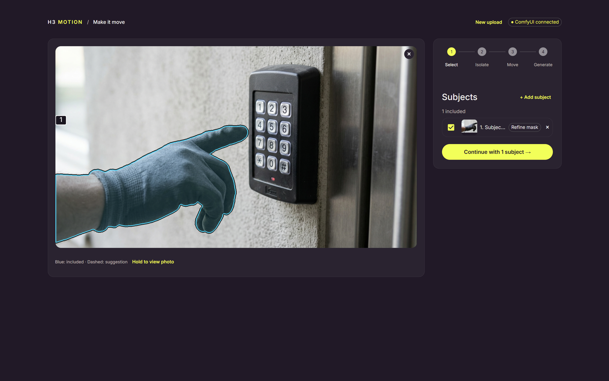
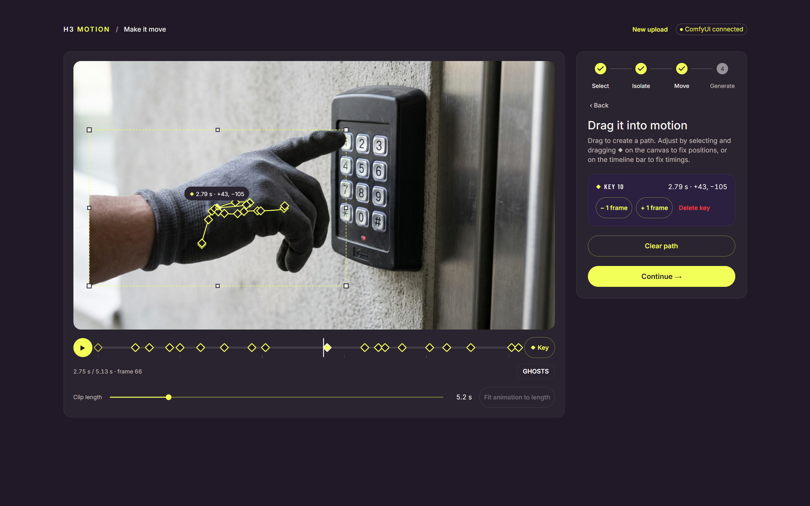

# H3 Motion

Lift a subject out of a photo and drag it into motion, or mask part of a video
and change what happens inside it. A standalone React app that drives a
self-hosted ComfyUI through the Comfy SDK, built for Comfy's Open Source
Higgsfield competition. It uses open-weights models only: no Comfy Router,
partner nodes or closed APIs.

- **Photos: Select → Isolate → Move → Generate.** Find a subject by name with
  SAM 3.1 and refine it with clicks. Qwen3-VL describes it and Qwen Image 2.1
  removes it, leaving a clean background. Drag each subject along a keyframed
  path, resizing or flipping it on the way, and MiniMax H3 animates the shot
  with Time-to-Move, with sound.
- **Videos: Draw mask → Animate → Generate.** Draw a rectangle or ellipse,
  animate it with the same path tools or have it follow an object, and describe
  what should appear. An optional reference image can be uploaded, generated
  from a description, or made by editing the current frame inside the mask. H3
  regenerates the masked region and the app composites it back into the
  source, keeping, referencing or replacing the original sound.

<p>
  
  
</p>

See [docs/usage.md](docs/usage.md) for the full walkthrough and
[docs/how-it-works.md](docs/how-it-works.md) for the pipeline.

## Requirements

- An NVIDIA or AMD GPU. Both H3 workflows use Comfy Kitchen INT8 attention.
- A recent [ComfyUI](https://github.com/Comfy-Org/ComfyUI). The app was tested
  at `6607f36b` (v0.41.0-18), which the checkout command below pins.
- My node pack [ComfyUI-vlo](https://github.com/PxTicks/ComfyUI-vlo) **0.3.0 or later**, for
  `vloTimeToMove`, `vloSAM3RefineMask` and `vloMaskToLatentMask`.
- Node.js **22.12+** (or 24+) and npm.
- [`uv`](https://docs.astral.sh/uv/), or
  [`comfy-api-proxy`](https://github.com/Comfy-Org/comfy-api-proxy) 0.1.6 or
  later on your PATH. The launcher uses it to start the API proxy.
- WSL, Linux or macOS for the launcher. On Windows, run ComfyUI natively and
  the app inside WSL.

## Setup

### 1. ComfyUI and ComfyUI-vlo

```sh
git -C /path/to/ComfyUI checkout 6607f36b53c7b695b160ac5b52d595e9e3752a2d
git clone https://github.com/PxTicks/ComfyUI-vlo.git /path/to/ComfyUI/custom_nodes/ComfyUI-vlo
```

No other node packs are needed.

### 2. Models

Run these from the ComfyUI root (the folder that contains `models/`). Each file
lands in the subfolder the workflows expect. Install the Hugging Face CLI with
`pip install -U huggingface_hub` if needed.

```sh
cd /path/to/ComfyUI
# Selection
hf download Comfy-Org/sam3.1 checkpoints/sam3.1_multiplex_fp16.safetensors --revision 7bb8374780a725b4353ed31f3a9395c9742b5621 --local-dir models
# Description, removal and reference images
hf download Comfy-Org/Qwen-Image-2.1 diffusion_models/qwen_image_2.1_int8_convrot.safetensors --revision 0217efd1d9c9452e84f6448903d6e21bfa171ffd --local-dir models
hf download Comfy-Org/Qwen-Image-2.1 text_encoders/qwen3vl_8b_int8_convrot.safetensors --revision 0217efd1d9c9452e84f6448903d6e21bfa171ffd --local-dir models
hf download Comfy-Org/Qwen-Image-2.1 vae/qwen_image_2.1_vae_bf16.safetensors --revision 0217efd1d9c9452e84f6448903d6e21bfa171ffd --local-dir models
# Generation: fl2va animates photos, ref2va inpaints videos
hf download Comfy-Org/MiniMax-H3 diffusion_models/minimax_h3_fl2va_pruned_int8_convrot.safetensors --revision 912b6e38b2092ec4d2e86d24183e0d59ea059d48 --local-dir models
hf download Comfy-Org/MiniMax-H3 diffusion_models/minimax_h3_ref2va_pruned_int8_convrot.safetensors --revision 912b6e38b2092ec4d2e86d24183e0d59ea059d48 --local-dir models
hf download Comfy-Org/MiniMax-H3 text_encoders/qwen3vl_32b_minimax_h3_nvfp4_awq.safetensors --revision 912b6e38b2092ec4d2e86d24183e0d59ea059d48 --local-dir models
hf download Comfy-Org/MiniMax-H3 vae/minimax_h3_video_vae_int8_convrot.safetensors --revision 912b6e38b2092ec4d2e86d24183e0d59ea059d48 --local-dir models
hf download Comfy-Org/MiniMax-H3 vae/minimax_h3_audio_vae_fp32.safetensors --revision 912b6e38b2092ec4d2e86d24183e0d59ea059d48 --local-dir models
```

The workflow templates use these exact filenames. If you keep models in other
folders or under extra model paths, the environment checker still finds them,
but nested subfolders need the template filenames edited to match ComfyUI's
loader options.

### 3. Run the app

Start ComfyUI on port `8188`, then:

```sh
npm install
npm run dev
```

Open http://127.0.0.1:5180. The launcher connects to the running ComfyUI,
including Windows ComfyUI from WSL, and starts the API proxy on `8189` if one
isn't already running. It never launches ComfyUI or downloads models. While it
runs, `npm run check-env` in another terminal checks the proxy and ComfyUI's
nodes and models.

To use a remote GPU, run `./run_remote.sh <URL>` with the ComfyUI or Paperspace
URL instead. Configuration in `.env` is optional; copy `.env.example` to
override the defaults. See [docs/development.md](docs/development.md) for the
launcher, ports, a manually run proxy, tests and spikes.

## License

[AGPL-3.0](LICENSE), matching the vlo source workflows carried into this
project; see [THIRD_PARTY_NOTICES.md](THIRD_PARTY_NOTICES.md). Dependencies
and model weights keep their own licences. Read each model card before use:

- **MiniMax H3** is under the
  [MiniMax H3 Community License](https://huggingface.co/MiniMaxAI/MiniMax-H3/blob/main/LICENSE).
  Its grant excludes the European Union, the United Kingdom, the Republic of
  Korea and the United States.
- **Qwen Image 2.1** is under the
  [Qwen Research license](https://huggingface.co/Qwen/Qwen-Image-2.1/blob/main/LICENSE).
- **SAM 3.1** is under the [SAM License](https://huggingface.co/Comfy-Org/sam3.1).

The app is independent and is not an official Comfy product. SDK integration
follows the
[official TypeScript SDK](https://github.com/Comfy-Org/comfy-typescript-sdk).
The original design notes are in [PLAN.md](PLAN.md).
